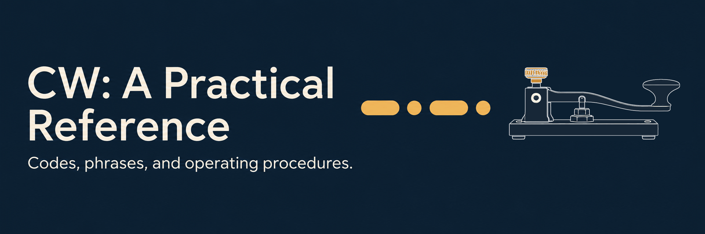

  <h1>CW: A Practical Reference</h1>
  
<em>Codes, phrases, and operating procedures.</em>

  
  
  
  
  

  

I’m new to amateur radio and Morse code. I found myself jumping between websites and guides just to check a code, a phrase, or what to send next. So I gathered the references I kept needing into one place, for myself and anyone else who finds them useful.

This is a reference for CW codes and operating procedures, rather than a complete beginner’s course. I’m still learning too. Corrections, clearer explanations, and practical examples are very welcome.

**[Download the latest PDF](https://github.com/Architeg/cw-ham-radio-reference/releases/latest)** · [What’s new](CHANGELOG.md)

**English community edition v1.0.0 · 2026 · A5 · 90 pages.**
[Read online](book/CW-Practical-Reference-English-A5-2026-v1.0.0.pdf) · [Direct PDF download](https://github.com/Architeg/cw-ham-radio-reference/releases/download/v1.0.0/CW-Practical-Reference-English-A5-2026-v1.0.0.pdf)

Save a copy for offline lookup or print the pages you want beside your key. The PDF includes a linked contents list and bookmarks to help you get back to a useful table quickly.

## What’s inside

- International Morse characters, punctuation, and joined procedure signals.
- 139 abbreviation entries, 38 Q signals, and 91 sample phrases.
- Worked contacts, signal reports, repeats, courteous operating, and logging.
- Key types, rhythm, offline practice, and optional web tools.
- A one-page desk card for the reminders you want within reach.

## Contribute

Found a mistake, an unclear explanation, or a useful example to add? [Open an issue](https://github.com/Architeg/cw-ham-radio-reference/issues) or send a small pull request. You don’t need to write code to help—describe the change in plain English and include a source when possible.

Questions from other newcomers are welcome too. Please mention the edition and page so we can find the passage. [Contribution notes](CONTRIBUTING.md) explain how to suggest an edit or rebuild the PDF.

## ⭐ Support CW: A Practical Reference

If this reference helps you look up CW codes, phrases, and operating procedures, you can [share it](https://twitter.com/intent/tweet?url=https%3A%2F%2Fgithub.com%2FArchiteg%2Fcw-ham-radio-reference&text=CW%3A%20A%20Practical%20Reference%20%E2%80%94%20Codes%2C%20phrases%2C%20and%20operating%20procedures.), [give it a star](https://github.com/Architeg/cw-ham-radio-reference/stargazers), or support the project:

  

## License

Original book content and artwork: [CC BY 4.0](LICENSE.md). Share and adapt with attribution. Build code: [MIT](tools/LICENSE.txt). Bundled [DejaVu fonts](assets/fonts/LICENSE.txt) retain their own terms.
